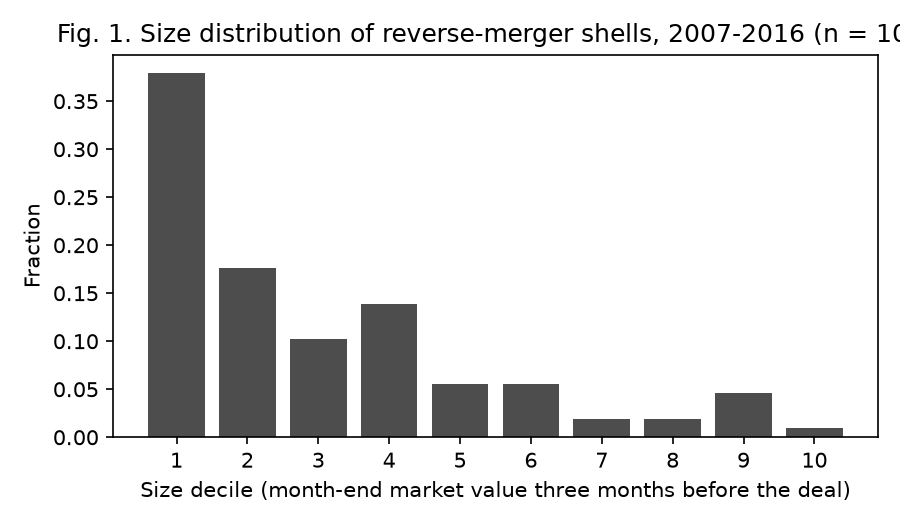
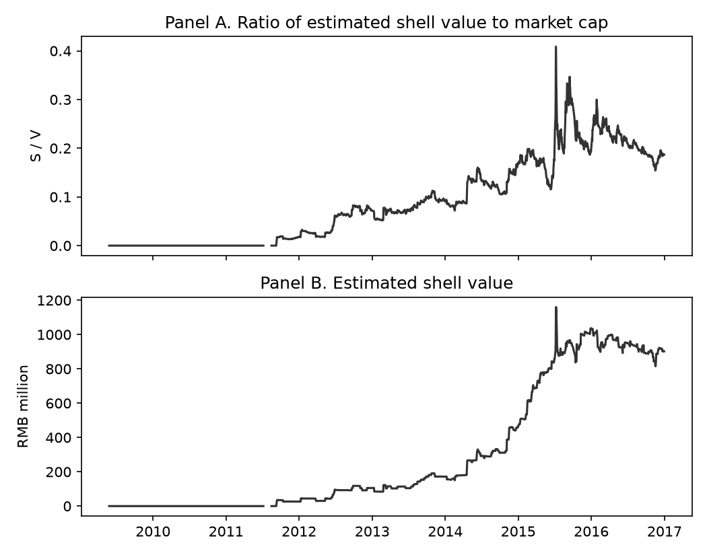
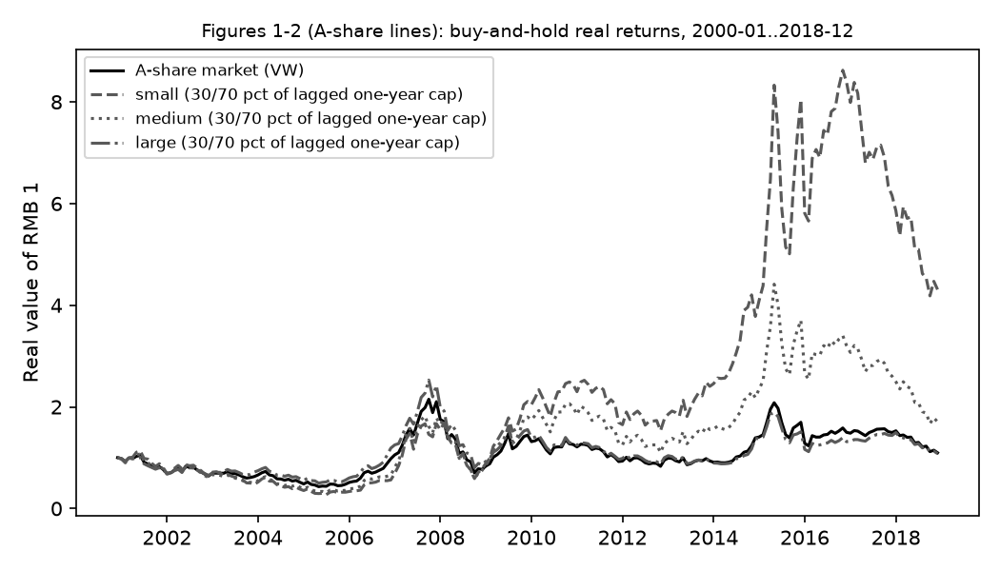
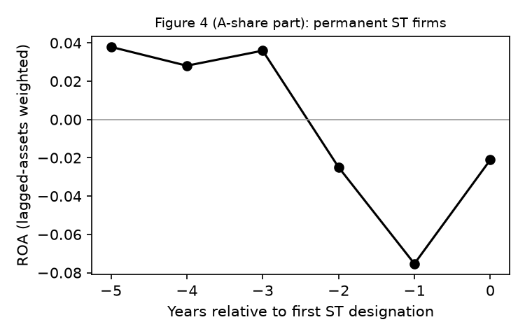
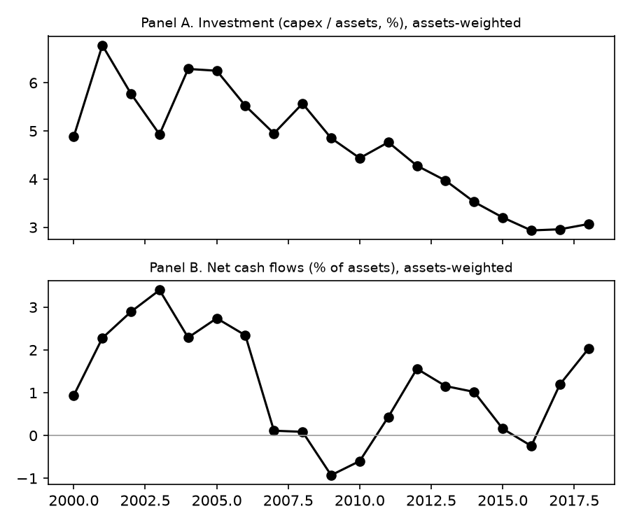

# 用 CSMAR 复现三篇 A 股论文：结果、偏差与延长到 2026 年

> 复现对象：
> - Liu、Stambaugh、Yuan（2019，JFE），"Size and value in China"（下称 LSY）；
> - Allen、Qian、Shan、Zhu（2024，JF），"Dissecting the long-term performance of the Chinese stock market"（下称 Allen）；
> - Li、Liu、Liu、Wei（2024，Management Science），"Replicating and digesting anomalies in the Chinese A-share market"（下称 Li）。
>
> 数据：CSMAR（NYU 订阅），以及少量公开外部数据（Stambaugh 官网 CH 因子、FRED、国家统计局 CPI、global-q.org）。
> 报告日期：2026-10-14。逐个数字的对照在 `results/*_comparison.csv`，每个未通过项的追查过程在 `docs/deviation_log.md`。

---

## 0. 结论一页

| | LSY（2019） | Allen（2024） | Li（2024） |
|---|---|---|---|
| 复现范围 | 正文全部表、图 1–2、正文数字 | 所有 A 股部分（跨国部分做不了） | 469 个异象、四种组合构造、表 1–7、第 4.2 节 |
| 打分的数字 | 836 | 257 | 4,270 |
| 在容差内 | **699（84%）** | **150（58%）** | **2,510（59%）** |
| 核心结论是否复现 | **是**。CH-3 因子（MKT、SMB、VMG）与官网序列逐月相关 ≥ 0.96；CH-3 对 10 个异象的平均 \|α\| 为 0.43%（论文 0.45%），远低于 FF-3 的 0.85%（论文 0.90%） | **大体是**。A 股长期实际收益很低（2000-12 至 2018-12 买入持有终值 1.10，论文 1.01）；大盘股显著跑输（表 XII 中 Large 系数 −8.0，t −3.4；论文 −6.4，t −4.0） | **是**。多数异象在中国不显著：失败率 82.6% / 82.8% / 85.4%（论文 83.4% / 84.2% / 87.0%）；主板断点加市值加权大幅降低显著率（主板-VW 17.4% 对全 A 等权 37.3%） |
| 主要偏差 | 借壳上市识别（CSMAR 无 WIND 的借壳标记）；个别异象 α 的显著性档位 | 国企口径（CSMAR 实际控制人 vs WIND）；治理指数与收益的关系变弱（G-Index-A t = 1.90，论文 2.89） | 价差、VPIN 类 15 个异象和专利 1 个数据未订阅；季度盈利类异象比论文强；作者流程里有前视（见 3.4） |
| 延长到 2026 年 | VMG 仍显著（2017-01 至 2026-09，月均 1.04%，t 2.60）；SMB 消失（0.03%）；CH-3 不再优于 FF-3 | A 股实际收益明显改善（2019–2025 买入持有终值 1.85）；大盘股跑输小盘股持续，但回归系数不再显著 | 异象几乎全部衰减（2019-07 至 2026-09 仅 4.4% 显著）；q 因子模型仍是解释力最强的模型 |

"容差"的定义在 lighthouse 3.3，主要几条：
- 月均收益：与论文相差不超过 0.10 个百分点；
- t 值：落在同一显著性档（\|t\| < 1.96、1.96–2.78、> 2.78）；
- 比例：相差不超过 3 个百分点；
- 计数：相对误差不超过 3%；
- 连续型描述统计：相对误差不超过 10%（2026-10-10 修订）。

这些标准相当严，尤其是计数。例如 Li 表 5、表 7 里个数只有十几到几十的格子，差一个异象就会判为未通过。所以通过率宜理解为"逐格一致的程度"，不宜理解为"结论是否成立"。下文对每篇分别给出结论层面的判断。

---

## 1. 做法要点

- **每篇按它自己的原始口径**复现，不统一三篇的口径：样本期、市值口径、剔除规则、无风险利率都按各自论文。
  - LSY：总市值加权，剔除最小 30%，一年期存款利率；
  - Li：流通市值加权，主板断点，三个月存款利率；
  - Allen：年度面板，美元市值加权回归。
- **三段**：原文样本期 / 原文截止后至最新月份 / 2000 年起全样本。三段由同一段代码只改日期产出。
- **防前视**：财务数据只在实际披露日（CSMAR `IAR_Rept` 的报告公布日期）之后使用；原文明确用固定滞后规则的，按原文规则（Li 的"6 月末用上年年报"、"季度科目滞后 4 个月"）。
- **对不上时**：每个未通过项最多追查三轮（假设 → 改动 → 结果），记入偏差日志；追查不出的如实标注。
- **有作者材料时逐月对照**，这比对表格数字更强：
  - LSY 的 CH 因子对照 Stambaugh 官网序列；
  - Li 的因子对照作者复现包里的 `allfactors`，每个显著异象的五分位收益对照作者的 `g5_g1` 序列；
  - Allen 的 SAS 代码只用来核对口径（缺输入数据，不能运行）。

---

## 2. LSY（2019）：Size and value in China

### 2.1 我们 vs 论文

| 表 | 内容 | 打分 | 通过 | 说明 |
|---|---|---|---|---|
| 表 1 | 盈余公告收益与规模 | 18 | 18 | 需剔除停牌期间的公告窗口（LSY-5，口径为我们所加） |
| 表 2 | 估值比率 Fama–MacBeth | 80 | 68 | 采用"不剔除最小 30%"的样本才能对上数字（LSY-3） |
| 表 3 | CH-3 因子 | 18 | 17 | 唯一未通过：MKT 的双因子 α 1.76 vs 1.57 |
| 表 4 | R² 比较 | 8 | 8 | |
| 表 5 | 因子互相定价 | 10 | 10 | |
| 表 6–10 | 10 个异象与模型比较 | 636 | 533 | 反转、BM、ROE、异常换手的 α 档位有差（LSY-7） |
| 第 5.2 节 | 剔除壳价值的稳健性 | 6 | 5 | |
| 图 1–2 | 借壳上市与壳价值 | 4 | 0 | 借壳识别规则不同（LSY-6） |
| 正文数字 | | 49 | 33 | |
| 因子逐月对照 | CH 七条序列 vs 官网 | 7 | 7 | 相关均 ≥ 0.96 |

**因子本身复现得很好**（表 3）：

| | 论文 | 我们 |
|---|---|---|
| VMG 月均（t） | 1.14%（4.34） | 1.18%（4.52） |
| SMB 月均（t） | 1.03%（3.25） | 0.98%（3.12） |
| SMB 与 VMG 的相关 | −0.62 | −0.61 |

七条因子序列（CH-3、CH-4 的 MKT / SMB / VMG / PMO）与 Stambaugh 官网序列逐月相关都在 0.96 以上。关键口径是 EP 用**单季度**盈余（LSY-1）：用年初至今累计盈余时，VMG 只有 1.04%。

**核心结论成立**（表 9）：CH-3 对 10 个异象的平均 \|α\| 为 0.43%，论文 0.45%；CAPM 为 0.94%（论文 1.02%），FF-3 为 0.85%（论文 0.90%）。唯一不同是 CH-3 的 GRS 检验：我们 p = 0.018 拒绝"α 全为零"，论文 p = 0.15 不拒绝。拒绝主要来自反转和异常换手两个异象的 α。

### 2.2 主要偏差及原因

1. **借壳上市（图 1–2）**：
   - LSY 用 WIND 的借壳标记，CSMAR 没有，我们按证监会定义写了规则：重大资产重组、以股份支付且标的资产不低于上年资产的 100%、同时实际控制人变更。
   - 2007–2016 年识别出 108 起，论文 133 起。来自最小 30% 股票的比例是 66%，论文 83%。
   - CSMAR 的并购表在 2012 年以前符合条件的交易很少，因此 2009–2016 年壳价值占市值的平均比例只有 8.9%，论文 29.5%。曲线形状对得上（2012 年起上升、2015 年见顶），水平对不上。
   - **识别规则需要您确认**（lighthouse 第 8 节）。
2. **表 2 的样本**：论文正文说剔除最小 30%，但只有不剔除时数字才对得上（logME 系数 −0.0051 对论文 −0.0049）。我们判断表格用的是全样本，两种版本都保留。
3. **个别异象的显著性档位**：
   - 反转的 CAPM α 为 1.16%（t 2.41），论文 1.49%（t 3.06）。
   - 追查三轮后，最可能的原因是 WIND 与 CSMAR 的日度收益在涨跌停日和复牌日不同。
   - 以 CH-4 为例：平均 \|α\| 0.44%，论文 0.30%；改用官网 CH-4 因子也是 0.41%，说明差距不在因子，而在用 CSMAR 数据构造的异象组合本身。

### 2.3 图





### 2.4 延长到 2026 年

| 段 | MKT 月均（t） | SMB 月均（t） | VMG 月均（t） |
|---|---|---|---|
| 原文 2000-01 至 2016-12 | 0.72%（1.26） | 0.98%（3.12） | 1.18%（4.52） |
| 延长 2017-01 至 2026-09 | 0.32%（0.74） | **0.03%（0.10）** | **1.04%（2.60）** |
| 全样本 2000-01 至 2026-09 | 0.58%（1.45） | 0.64%（2.70） | 1.13%（5.13） |

- **价值效应延续**：VMG 在 2017 年后仍有月均 1.04%，t = 2.60，样本更短，显著性下降。
- **规模效应消失**：剔除壳价值后的 SMB 在 2017 年后为零。这与 2017 年起 IPO 提速、借壳需求下降、壳价值缩水的叙事一致。
- **CH-3 的优势没有延续**：2017–2026 年 10 个异象的平均 \|α\| 为 CH-3 0.64%、FF-3 0.54%、CAPM 0.86%。CH-3 不再是三个模型中最好的；全样本上 CH-3（0.56%）仍略优于 FF-3（0.67%）。
- 注意：Stambaugh 官网序列只到 2021-12。延长段用我们按同一方法自建的 CH-3，它与官网序列在 2000–2021 年逐月相关 ≥ 0.96。

---

## 3. Allen（2024）：Dissecting the long-term performance of the Chinese stock market

### 3.1 我们 vs 论文

| 表 / 图 | 内容 | 打分 | 通过 | 说明 |
|---|---|---|---|---|
| 表 I | 上市公司数、国企数、平均资产 | 60 | 41 | 公司数 19 年全部在 3% 内；国企数偏差见下（ALN-1） |
| 表 VIII–IX | 治理指数、换手率 | 53 | 44 | 治理各分项对得上 |
| 表 X | 治理、行为偏差与收益 | 36 | 11 | G-Index-A 系数方向一致但显著性弱（ALN-4） |
| 表 XI | 治理与经营表现 | 16 | 10 | |
| 表 XII（A 股部分） | 大盘股与国企 | 32 | 21 | 大盘股系数四列同号同档（ALN-9） |
| 表 XIII | 关联交易与 A+H 交叉上市 | 41 | 18 | 关联交易口径（ALN-5） |
| 图 1–2 | 买入持有实际收益 | 1 | 1 | 终值 1.10，论文 1.01 |
| 图 4–5、第 III.A.2 节 | ST、投资、退市 | 6 | 1 | |
| 正文数字 | | 12 | 3 | |

**核心结论成立**：
- **A 股长期实际收益很低**：2000-12 买入 1 元（实际值），到 2018-12 值 1.10 元，论文 1.01 元。
- **大盘股显著跑输**：表 XII 第 1 列 Large 系数为 −8.0 个百分点/年（t −3.4），论文 −6.4（t −4.0）。投资列 0.58（t 6.8），论文 0.46（t 6.0）。
- **IPO 前后业绩大幅下滑**：上市前一年 ROA 14.3%，上市后一年 7.2%；论文 13% → 6%。
- **ST 公司**：2000–2018 年首次被 ST 的公司 562 家，论文 572 家。

### 3.2 主要偏差及原因

1. **国企口径**：
   - 我们用 CSMAR 实际控制人性质定义国企，论文用 WIND 的"最终控制人"。2003–2014 年我们的国企数比论文多 10–19%，2015 年论文序列跳升 23%，而我们的几乎不变。
   - 控制人文件从 2003 年开始，2000–2002 年按每家公司最早观测到的状态回溯。回溯后 2000 年国企占比 73.2%，论文正文为 70%。
   - 这影响所有含国企的回归。例如表 XII 投资列的国企系数，我们为负且显著，论文为正、不显著。
2. **治理与收益的关系弱于论文**：表 X 第 1 列 G-Index-A 系数为 1.09（t 1.90），论文 1.45（t 2.89），系数大小在容差内，显著性低一档。回归观测数为 30,256，论文为 36,044（ALN-4）。
3. **关联交易方向**：用 CSMAR 关联交易表算出的"关联交易净流出"均值为负（−0.0068），论文为正（0.007）。三种口径（只算资金往来、按类别算现金流、把向关联方销售算作流出）都是负数（ALN-2），表 XIII 中与之相关的系数方向也因此不同。
4. **做不了的**：
   - 所有跨国表（表 II–VII、表 XII Panel B–C）需要 Worldscope、BoardEx、RiskMetrics；
   - AH 溢价需要港股价格，NYU 未订阅港股市场库。

### 3.3 图







图 4 的形态与论文一致：ST 前五年到三年 ROA 为正，前两年转负，被 ST 当年为 −25.9%。

### 3.4 延长到 2025 年

| 段 | 买入持有终值（实际）：全市场 / 小盘 / 中盘 / 大盘 | 表 XII Large 系数（t） | 表 X G-Index-A 系数（t） |
|---|---|---|---|
| 原文 2000–2018 | 1.10 / 4.31 / 1.70 / 1.08 | −8.0（−3.4） | 1.09（1.90） |
| 延长 2019–2025 | 1.85 / 2.79 / 1.85 / 1.80 | −5.1（−1.6） | 0.36（0.65） |
| 全样本 2000–2025 | 2.09 / 12.6 / 3.29 / 1.99 | −6.2（−2.9） | 0.74（1.49） |

- **"A 股长期表现差"在 2019 年后明显改善**：七年实际收益 85%（终值 1.85），全样本终值从 1.10 升到 2.09。
- **大盘股跑输小盘股的现象延续**：2019–2025 年大盘 1.80、小盘 2.79。但控制其他变量后，Large 系数在延长段已不显著（t −1.6）。
- **治理指数与收益的关系在延长段消失**（t 0.65）。

---

## 4. Li（2024）：Replicating and digesting anomalies in the Chinese A-share market

### 4.1 我们 vs 论文

| 表 | 内容 | 打分 | 通过 | 说明 |
|---|---|---|---|---|
| 表 1 | 样本、11 个因子、相关矩阵 | 530 | 526 | 样本 300 格中 299 格一致；CH 系列一致 |
| 表 2 | 微盘股与投资容量 | 208 | 143 | 微盘股权重 56 格中 53 格通过 |
| 表 3 | 四种构造的显著率 | 168 | 52 | 总显著率接近，分类构成不同 |
| 表 4 | 显著异象的多空收益 | 280 | 142 | |
| 表 5–6 | 七个因子模型 | 2,616 | 1,499 | 价差类缺失影响最大 |
| 表 7 | 国企 / 非国企 | 448 | 139 | 国企子样本显著个数 43，论文 44 |
| 正文数字、第 4.2 节 | | 20 | 9 | 美国对照 2008 年后显著率 16.04%，与论文完全相同 |

**数据和工具的复现程度很高**：
- 样本：表 1 Panel A 各板块公司数、总市值、流通市值 20 年 × 15 列，300 格中 299 格与论文一致。
- 无风险利率：三个月存款利率与作者的月度序列 228 个月全部一致。
- 因子：11 个自建因子中 9 个与作者序列逐月相关 ≥ 0.95，RMW 为 0.906（差距几乎全在 2006-10 一个月），MOM 为 0.70（LI-1）。
- 异象：作者复现包里有 139 条显著异象的五分位收益序列，我们能构造其中 117 条，99 条逐月相关 ≥ 0.90。最高的 Srev 为 1.000，Ivc 为 0.998。

**核心结论成立**：

| | 论文 | 我们 |
|---|---|---|
| 主板-VW 显著率（\|t\| ≥ 1.96） | 16.6%（78/469） | 17.4%（79/453） |
| 失败率：原始 / CAPM / FF3 | 83.4% / 84.2% / 87.0% | 82.6% / 82.8% / 85.4% |
| 主板-VW vs 全 A 等权显著率 | 16.6% vs 47.6% | 17.4% vs 37.3% |
| 最低五分位里的微盘股权重：主板-VW vs 全 A 等权 | 8.2% vs 26.9% | 7.7% vs 26.6% |
| 2008 年后显著个数 | 61 | 58 |
| 被各模型"解释"的显著异象比例：CH3 / CH4 / q | 54% / 47% / 26% | 73% / 73% / 54% |

关于最后一行：
- 两边的排序一致（CH3、CH4 强于 q），2008 年后都是 q 最强（论文 74%，我们 90%）。
- 我们的"解释比例"整体偏高，因为论文中 12 个难以解释的价差 / VPIN 异象我们做不了（LI-7）。用论文自己的显著集合重算后，CH3 下仍显著的个数为 22/66，论文为 36/78，扣掉这 12 个后约 24。

### 4.2 主要偏差及原因

1. **数据未订阅（16 个异象）**：
   - 有效价差、报价价差、VPIN（共 15 个）需要 CSMAR"已实现指标"库，专利（Parc，1 个）需要"上市公司研发创新"库，NYU 都没有订阅。
   - 论文 78 个显著异象中有 12 个在其中，所以我们的交易摩擦类显著率偏低（21.9%，论文 32.2%）。
2. **用替代数据构造的变量**：
   - 研发支出：数据手册所用的研发投入表未订阅，用管理费用代替，与作者在季度研发变量中的做法相同；
   - 治理指数：缺机构持股，用其余 6 个输入；
   - 操控性应计：按修正 Jones 模型自建；
   - Pástor–Stambaugh 流动性：CSMAR 序列未订阅，按原方法自建，与作者序列相关 0.67。
3. **季度盈利类异象比论文强**：
   - 例如 Roeq1 月均 0.81%（t 2.29），论文 0.48% 且不显著。
   - 时点规则用作者序列校准过：Sue、dRoe、dRoa 的相关在 0.87–0.99。
   - 最可能的原因是 CSMAR 季度报表和公告日期的数据版本不同（作者 2019–2021 年取数）。
4. **作者流程里的前视**（LI-2）：
   - 数据手册说剔除 5 元以下股票，但只有同时剔除"**持有月月末**价格低于 5 元或交易状态异常"的股票，组合收益才能与作者逐月吻合：价格排序各组差距中位数为 0.000–0.002 个百分点，相关 0.997–1.000。
   - 持有月月末的价格和状态在建仓时并不知道，这是作者流程里的前视。
   - 处理方式（您的决定）：原文段与论文对照时用作者流程；延长段和全样本以无前视版为主，作者流程版附后。
   - 去掉前视后，原文段显著率从 17.4% 升到 26.7%（121 个），原因还没查清。
5. **作者实现与数据手册文字不一致的其他地方**（按作者序列校准后采纳，均记录在 LI-3）：
   - Rdmq 的市值用 t−1 月末而非上年末：相关从 0.83 升到 0.977；
   - 季节性变量允许部分滞后月缺失。

### 4.3 延长到 2026 年

以无前视版为主：

| 段 | 主板-VW 显著个数（比例） | 剩余显著最少的因子模型 |
|---|---|---|
| 原文 2000-07 至 2019-06 | 121（26.7%）；作者流程版 79（17.4%） | q |
| 延长 2019-07 至 2026-09 | **20（4.4%）**；作者流程版 12（2.6%） | q（20 个中仍显著 9 个，平均 \|α\| 0.65%） |
| 全样本 2000-07 至 2026-09 | 109（24.1%） | q（109 个中仍显著 33 个） |

- **异象在 2019 年后几乎全部衰减**，延长段显著率只有 4.4%，接近随机水平（5%）。可能的解释包括：注册制改革后供给增加、量化资金增加使异象被套利、样本期短（87 个月）检验力不足。
- **q 因子模型仍是解释力最强的模型**，与论文 2008 年后的结论一致。
- CH-3 / CH-4 只能算到 2021-12（官网数据截止）。

---

## 5. 做不了的部分及原因

| 论文 | 项目 | 原因 |
|---|---|---|
| LSY | 第 6.1 节中价反转（mid-price reversal） | 需要买卖报价，CSMAR 订阅中没有 |
| LSY | 借壳上市的 WIND 标记 | CSMAR 无此字段，改用规则识别（需您确认规则） |
| Allen | 表 II–VII、表 XII Panel B–C（跨国比较、上市前财务、与未上市公司匹配） | 需要 Worldscope、BoardEx、RiskMetrics、工业企业数据库，不在 lighthouse 范围 |
| Allen | AH 溢价（表 IX、表 X 第 2、5 列） | NYU 未订阅港股市场库 |
| Allen | 2000 年国企数（表 I 2000–2002 年） | 控制人文件从 2003 年开始，用回溯值代替，已打分 |
| Allen | 图 4 与美国退市公司对比的 t 值 | 需要美国数据 |
| Li | Esba、Qsba、Vpin（15 个异象） | CSMAR 已实现指标库未订阅（2026-10-13 核对） |
| Li | Parc（1 个异象） | 专利库未订阅 |

---

## 6. 数据与已知偏差

1. **CSMAR 文本字段缺陷**：
   - 交易停复牌表和并购重组表中有 21 条记录的文本字段含未转义的引号，Python 标准 CSV 解析会把记录拆错或并错。
   - 我们写了按 CSMAR 固定引号格式切分的解析器，每个分块的行数都与平台显示的记录数一致，受影响的记录原样保留并在每次读取时记录（D-009）。
   - 控制人文件、关联交易表等含长文本的表，在下载时就不选这些文本字段，只保留结构化字段。
2. **差错更正**：CSMAR 资产负债表有 7.8% 的行标记"发生差错更正"。核查后确认，期末行保存的是**原始报告值**，更正后的值只出现在下一年的期初行（YYYY-01-01）。因此我们只用期末行，不存在用更正值造成的前视。期初行永远不当作报告期使用。
3. **CPI 缺口**：
   - FRED 的 OECD 中国 CPI 只到 2025-04；
   - 2025-05 之后用国家统计局网页的环比指数接续，重叠期核对差距不超过 0.2；
   - Allen 的实际收益最晚做到 2026-08。
4. **行业代码只有当前值**（D-001）：CSMAR 公司文件的行业代码是最新分类，历史年份的行业归属可能与当时不同，影响需按行业分组的变量（如 Li 的 dIi、Allen 的行业固定效应）。
5. **无风险利率口径**：
   - LSY 用一年期存款利率。CSMAR 的这条序列在 2022-09 后从央行基准切换为大行挂牌利率（D-005），延长段已注明。
   - Li 用三个月存款基准利率，央行自 2015-10 后未调整。
6. **数据版本**：三篇论文分别在 2018–2023 年取数，CSMAR 此后修订过部分历史数据（季度报表、公告日期、复权收益）。有作者序列可对照时：
   - 差距多集中在少数月份（如 2006-10、2015 年股灾停牌期）；
   - 少数大公司的分组归属不同，而不是整体口径错误。
7. **国企口径**：Li 和 Allen 原用的国企数据源（CSMAR 股权性质库、WIND）都不可得，统一用 CSMAR 上市公司控制人文件。2003 年末国企占比 75.1%，Li 论文为 74.57%。

---

## 7. 需要您亲自验收的项（lighthouse 第 8 节）

1. 复现的图与原图是否"看起来一致"：
   - LSY 图 1–2（`results/lsy/figures/`）；
   - Allen 图 1/2/4/5（`results/allen/figures/`）；
   - 三段各一张。
2. 借壳上市识别规则是否合理（规则见 2.2 第 1 条，代码在 `src/replication/lsy/shells.py`）。
3. 本报告是否清楚、是否适合给导师看。

---

## 附：复跑方式

在项目根目录 `~/Downloads/stock-exploration`：

```bash
.venv/bin/python -m csmar.build && .venv/bin/python -m csmar.validate
.venv/bin/python -m replication.lsy
.venv/bin/python -m replication.allen
.venv/bin/python -m replication.li --build
LI_VARIANT=clean .venv/bin/python -m replication.li --build
```

逐个数字的对照：`results/lsy_comparison.csv`、`results/allen_comparison.csv`、`results/li_comparison.csv`（每行含论文值、我们的值、容差类型、是否通过、偏差日志编号）。
